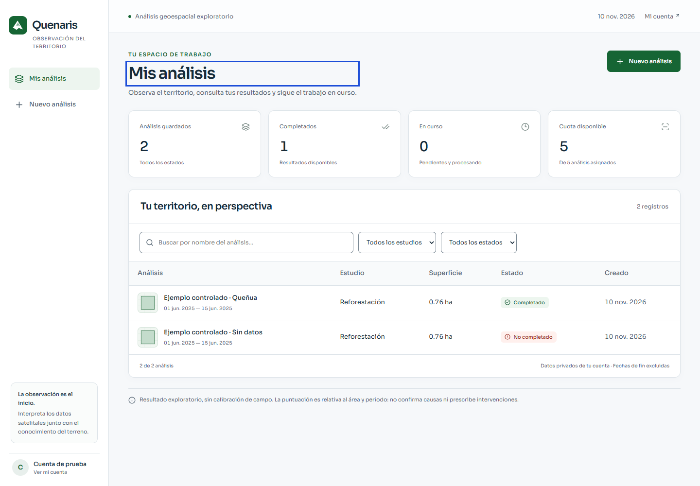

<div align="center">

# Quenaris

**Exploración satelital para comprender el territorio**

Proyecto ganador del NASA Space Apps Challenge 2025, desarrollado con Arequipa y los ecosistemas altoandinos como contexto.

</div>

Quenaris ayuda a agrónomos y técnicos a explorar diferencias dentro de un terreno usando imágenes Sentinel-2 y datos topográficos. Permite delimitar un área, analizar un periodo y consultar grupos, mapas mensuales y un informe con la calidad y las limitaciones de los datos.

> **Resultados exploratorios, sin calibración de campo.** La puntuación es relativa al área y periodo analizados. No demuestra salud, fertilidad, presencia de plagas ni éxito de una plantación y no prescribe intervenciones. Las observaciones deben contrastarse en campo.



*Captura con datos controlados de prueba.*

## Qué permite hacer

- **Portada pública y destacados:** explorar una selección de proyectos elegidos por la administración sin iniciar sesión; el login también ofrece acceso a esta galería.
- **Mis análisis:** buscar y filtrar trabajos pendientes, en proceso, completados y fallidos; recuperar su estado después de recargar.
- **Compartidos conmigo:** guardar enlaces recibidos, volver a abrirlos y quitarlos de tu colección. El propietario conserva el control del acceso.
- **Nuevo análisis:** elegir un estudio, dibujar un polígono o importar coordenadas CSV, definir el periodo y revisar la cuota y los parámetros antes de enviar.
- **Resultados:** consultar cobertura utilizable, escenas, puntuación relativa, grupos, mapas mensuales, datos técnicos, informe imprimible y vista 3D.
- **Mapas ampliados:** dibujar en una vista que ocupa la ventana y ampliar los resultados o el relieve 3D con la leyenda y los controles visibles.
- **Acceso privado:** entrar con usuario y contraseña o, si está configurado, con Google. Los análisis y mapas están asociados a su propietario.
- **Compartir por enlace:** el propietario puede activar un interruptor en un análisis completado para consultar sus resultados sin iniciar sesión. Al desactivarlo se revoca el enlace y sus mapas; volver a activarlo genera uno nuevo. Consulta [funcionamiento y revisión local](docs/security/compartir-analisis.md).
- **Selección de proyectos:** las cuentas administradoras pueden destacar proyectos propios con enlace activo o proyectos que hayan recibido, y agregar una imagen de portada. Desactivar el enlace retira también el destacado. Consulta [portada, recibidos y permisos](docs/security/descubrir-proyectos.md).

Se conservan cinco estudios. Salud general y potencial de reforestación son los contextos priorizados para exploración; **estado hídrico, fitosanidad y nutrición son experimentales**. Ninguno está calibrado con observaciones de campo.

## Interpretación científica

El motor `relative-percentiles-v2` calcula índices espectrales y variables topográficas, agrupa píxeles y combina índices en una puntuación relativa de 0 a 100. La normalización depende del área y del periodo: las puntuaciones de áreas o periodos distintos no son una escala agronómica absoluta.

El procesamiento usa Sentinel-2 SR Harmonized, excluye clases no utilizables mediante SCL y registra cobertura, observaciones y escenas disponibles. La cuadrícula de análisis es de 20 m; los datos originales tienen resoluciones distintas y el DSM es de aproximadamente 30 m. Los mapas mensuales utilizan la referencia del análisis principal; sus diferencias son descriptivas y pueden estar afectadas por la cobertura disponible. El periodo de consulta incluye la fecha inicial y excluye la final.

Los informes actuales son deterministas y no llaman a un modelo de IA. Los resultados históricos pueden carecer de metadatos o usar una versión científica anterior. Consulta la [auditoría científica](docs/science/AUDIT.md) para ver fórmulas, fuentes, supuestos, limitaciones y el protocolo de validación en campo.

## Arquitectura

| Componente | Tecnología y función |
| --- | --- |
| Frontend | React, TypeScript, Vite, React Router y TanStack Query; mapas MapLibre y gráficos Chart.js. |
| API y administración | Django, GeoDjango y Django REST Framework. La administración se sirve por separado. |
| Procesamiento | Celery y Redis coordinan los trabajos; Google Earth Engine aporta las imágenes y el análisis geoespacial. |
| Persistencia | PostgreSQL/PostGIS guarda solicitudes y resultados; un volumen separado almacena los mapas generados. |
| Entrega | Docker Compose; Nginx sirve los archivos del frontend. Node se usa durante la construcción. |

## Ejecución local con Docker

Necesitas Git, Docker con el complemento Compose y acceso a internet. Para ejecutar análisis reales también necesitas un proyecto de Google Earth Engine habilitado y una cuenta de servicio con acceso. Consulta la [configuración de Earth Engine](docs/integration/README.md) y la [guía de seguridad](docs/security/README.md).

1. Clona el repositorio y prepara la configuración:

   ```bash
   git clone https://github.com/BorixQ/quenaris_mvp.git
   cd quenaris_mvp
   cp .env.example .env
   mkdir -p credentials
   python3 -c 'import secrets; print(secrets.token_urlsafe(50))'
   ```

2. Edita `.env`: configura `DJANGO_SECRET_KEY` con la clave generada, establece `POSTGRES_PASSWORD` y completa `GEE_PROJECT`, `GEE_SERVICE_ACCOUNT` y `GEE_PRIVATE_KEY_FILE`. La plantilla contiene el resto de opciones. Copia la clave JSON de la cuenta de servicio a `credentials/gee-sa-key.json`. Sin credenciales de Earth Engine se puede iniciar la interfaz, pero no ejecutar un análisis real.

3. Construye e inicia los servicios y crea una cuenta administradora:

   ```bash
   docker compose config --quiet
   docker compose up -d --build
   docker compose exec web python manage.py createsuperuser
   docker compose exec worker python manage.py check_gee
   ```

4. Abre [Quenaris](http://localhost:8080/analisis) e inicia sesión con la cuenta creada. La [administración Django](http://localhost:8001/admin/) requiere credenciales de administrador y solo escucha en la máquina local. El acceso con Google es opcional y requiere configurar `GOOGLE_OAUTH_CLIENT_ID` y los orígenes autorizados; es independiente de las credenciales de Earth Engine.

La configuración de integración utilizada durante el desarrollo tiene su propio Compose: en este equipo sirve la aplicación en el puerto **8080** y el administrador en **18081**. Sus pasos y requisitos se describen en [Integración y dependencias](docs/integration/README.md). No abras los archivos HTML directamente desde el explorador de archivos.

## Flujo de uso

1. Entra y selecciona **Nuevo análisis**.
2. Elige el estudio y, si lo deseas, asigna un nombre.
3. Delimita el terreno dibujando un polígono o importando un CSV con columnas de longitud y latitud.
4. Define el periodo. Los algoritmos, grupos, PCA e índices manuales están en configuración avanzada.
5. Revisa superficie, fechas y cuota; envía el trabajo. La interfaz muestra el estado que devuelve el servidor.
6. Al finalizar, consulta el resumen, los mapas y sus leyendas, los datos técnicos, el informe y la vista 3D. Ten en cuenta las advertencias y los meses sin datos.

## Desarrollo y pruebas

El frontend actual está en `frontend/app`. Con Node 24.22.1 o compatible:

```bash
cd frontend/app
npm ci --ignore-scripts
npm run build
npm test
```

Las pruebas de integración del backend y de navegador requieren preparar el entorno aislado. Para los comandos, dependencias, datos de prueba y limitaciones de las pruebas E2E, consulta [integración](docs/integration/README.md) y [frontend](docs/frontend/README.md). La última verificación local registró 62 pruebas de backend, 16 pruebas del frontend y 14 pruebas de navegador; también se comprobó la integración con Google y Earth Engine reales. Estas comprobaciones técnicas no sustituyen la validación científica ni una evaluación de usabilidad con agrónomos.

## Seguridad y despliegue

El Compose principal liga la aplicación y la administración a la máquina local por defecto. Los mapas privados pasan por Django y requieren autenticación y propiedad del análisis. La base de datos y los archivos de mapas están en volúmenes diferentes y deben respaldarse y restaurarse por separado.

Los análisis empiezan privados. Compartir es una decisión explícita del propietario y revela la ubicación del terreno, resultados, mapas e informe a quien tenga el enlace. La vista compartida permite lectura y conserva las advertencias científicas.

No incluyas `.env`, `credentials/` ni claves en Git. Antes de exponer la aplicación en una red o desplegarla en el homelab, revisa la [guía de seguridad](docs/security/README.md) y [HOMELAB.md](HOMELAB.md). El rendimiento y la restauración de copias aún deben verificarse en la laptop del homelab.

## Documentación

- [Auditoría científica y protocolo de campo](docs/science/AUDIT.md)
- [Diseño, frontend y pruebas](docs/frontend/README.md)
- [Integración y dependencias](docs/integration/README.md)
- [Seguridad y acceso privado](docs/security/README.md)
- [Saldo acumulado y transición de cuotas](docs/security/cuotas-area.md)
- [CI/CD y despliegue en el homelab](docs/integration/ci-cd-homelab.md)
- [Registro autónomo y acceso por correo](docs/security/registro-autonomo.md)
- [Preparación del homelab](HOMELAB.md)
